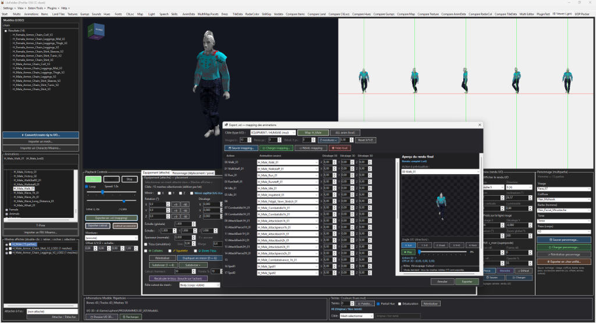

# Granny 3D Viewer — UOFiddler Plugin



An advanced, high-performance 3D Granny (`.grn` / UO 3D), Mixamo, and mesh inspection plugin for **[UOFiddler](https://github.com/Asylum-UO/UoFiddler)** (.NET 10). 

Designed for Ultima Online shard creators, artists, and modders to inspect, assemble, rig, animate, and export 3D characters, monsters, and equipment directly into classic Ultima Online 2D animations (`.vd` / `anim.mul` / uop).

---

## ✨ Features

### 🎮 1. Real-time OpenGL 3D Engine & Granny Parser
- **Hardware-accelerated rendering** (OpenTK 4.x / OpenGL 3.3+).
- **Native Granny 1.0 support**: reads UO 3D meshes, skeletons, bind poses, and bone animation tracks without external tools.
- **Hierarchical tree navigation**: browse models sorted by category (*Humans*, *Monsters*, *Animals*, *Sea Creatures*, *Equipment*, *Custom Meshes*).
- **Animation player**: complete playback controls (Play, Pause, Stop, Loop, Timeline scrubber, Speed multiplier 0.1x – 3.0x).

### 🎬 2. Ultima Online 2D Isometric Render & Camera
- **2:1 Isometric orthographic camera**: accurate pixel-perfect representation of classic Ultima Online viewing angles.
- **5-direction sheet or single view**: preview directions (South, South-East, East, North-East, North).
- **Precise calibration**:
  - Zoom & inclination angle (26.565°).
  - Vertical scaling & brightness correction.
  - "Feet on red line" grounding.
  - Live reference overlay with classic UO animations (body 400 `c_man` superposition) with opacity and scaling adjustments.
- **Quick Presets**: Instant switching between *Character*, *Monster*, and *Default* camera setups, plus custom Save/Load camera configurations.

### 🛡️ 3. Equipment Attachment, Posing & Cloth Simulation
- **Bone attachment**: attach any clothing, helmet, weapon, or armor piece to any skeleton bone or skin wrap.
- **Transform studio**: live X/Y/Z position offset, 3-axis rotation, scale, and Left ↔ Right mirroring.
- **Geometry enhancements**: mesh subdivision (1 → 4) and surface smoothing.
- **Clothing simulation**:
  - Live cloth physics simulation with gravity and stiffness.
  - Mesh-to-mesh body collision push-out margin.
  - Shrink / Sew fitting controls.
  - Cloth baking across full animation cycles.
- **One-click "💾 Figer & Enregistrer"**: bake modifications permanently into the model.

### 👤 4. Multipart Character Studio
- **Composite human characters**: customize Face, Hair, Beard, Torso, and Skin textures simultaneously.
- **Save & Load characters** (`.char` format) to easily reproduce complex multi-part NPC and player configurations.

### ⚡ 5. Mixamo & Custom 3D Import & Auto-Rigging
- **Import FBX / OBJ / DAE / SMD** via Assimp.
- **Mixamo auto-rigging**: retarget Mixamo humanoid skeletons directly onto standard UO skeletons with automatic bone weight transfer.

### 💾 6. Complete `.vd` (Ultima Online Animation) Exporter
- **Animation mapping matrix**: map UO action slots (*Walk*, *Run*, *Idle*, *Combat*, *Attack*, *Cast*, *Die*, etc.) to source animations.
- **Per-action frame control**: customize the exact number of frames per action (e.g. 5, 8, 10 frames) or leave as `Auto` based on clip duration.
- **MUL animation frame copier**: copy the exact frame distribution from any classic UO creature (`anim*.mul`) by selecting its name or Body ID (e.g., Ogre, Centaur, Dragon, Human) for 100% authentic timing in-game.
- **Directional centering & pivot compensation**: perfectly aligned 5-direction isometric rendering. Eliminates lateral shift on quadrupeds, mounts, and centaurs across profile (West) and diagonal (South-West, North-West) views.
- **Smart mount cutout occlusion**: dynamically occludes the rider only during mounted actions (*Walk*, *Run*, *Idle*, *Fidget* on horse) and displays the character unoccluded on all ground actions.
- **Live export preview**: real-time frame-by-frame and direction preview with accurate occluders and grounding before baking.
- **Save / Load mapping profiles**: export configurations can be saved and reused across multiple meshes.
- **Cutout roles**: distinguish visible Body meshes from occluders (Accessory, Mount) for accurate layered rendering.

### 🎨 7. Native Palette & Hue Support (`hues.mul`)
- Direct integration with UOFiddler's `hues.mul`.
- Color picker popup dialog, partial hue mode, and desaturation toggle.

---

## 🌟 Dernières Nouveautés & Correctifs Récents

- **Gestion des frames par action & Copie depuis les fichiers MUL** :
  - Ajout d'une colonne *Frames* dédiée dans la matrice d'export `.vd`.
  - Outil intégré de duplication du nombre de frames depuis n'importe quelle créature UO existante (sélection par Body ID ou nom de créature dans les MULs).
  - Mode "Auto" intelligent conservé par défaut, avec protection anti-réentrance lors de la saisie.
- **Correctif d'alignement directionnel & Centrage (.vd & preview)** :
  - Résolution du décalage latéral observé sur les créatures asymétriques le long de l'axe longitudinal (centaures, chevaux, quadrupèdes).
  - L'ancre horizontale $X$ (`centerX`) est désormais rigoureusement verrouillée sur le pivot de rotation normalisé du modèle et le décalage caméra, éliminant tout décalage parasite en vue Ouest / profil.
  - Correspondance exacte pixel par pixel entre la fenêtre de prévisualisation et le fichier `.vd` final dans UOFiddler / Ultima Online.
- **Rôle de découpe monture contextuelle (Cutout / Occluder)** :
  - Les montures sélectionnées en tant qu'occulteurs ne masquent désormais le cavalier que sur les actions montées (actions 23-29 et UOP 29-31), laissant les actions à pied totalement libres d'occlusion.
  - Synchronisation en direct dans la fenêtre de prévisualisation d'export.

---

## 🚀 Installation

1. Compile the project in **Release** mode (`net10.0-windows`):
   ```bash
   dotnet build UoFiddler.Plugin.Granny3D\UoFiddler.Plugin.Granny3D.csproj -c Release
   ```
2. Copy the contents of:
   ```
   UoFiddler\bin\Release\plugins\
   ```
   into the `plugins\` folder of your **UOFiddler** directory.
   
   *(The plugin is completely autonomous: managed assemblies, native libraries `assimp.dll`, `glfw3.dll`, and `runtimes/` are self-contained inside `plugins/`).*

3. Launch **UOFiddler**, open the menu:
   ```
   Plugins ➔ Gérer les plugins (Manage Plugins)
   ```
   Check **Granny 3D Viewer**. The **"3D Viewer (.grn)"** tab will appear!

---

## 🛠️ Requirements

- **Operating System**: Windows 10 / 11 (x64)
- **Host Application**: [UOFiddler](https://github.com/Asylum-UO/UoFiddler) (.NET 10.0 Windows)
- **Runtime**: [.NET 10.0 Desktop Runtime](https://dotnet.microsoft.com/)
- **Graphics**: OpenGL 3.3+ compatible GPU

---

## 📁 Repository Structure

```
├── UoFiddler.Plugin.Granny3D/     # Main plugin codebase
│   ├── Granny3DControl.cs         # Core UI and rendering viewport
│   ├── GrannyFormatParser.cs      # Native Granny 1.0 (.grn) file parser
│   ├── GrannyViewerPluginBase.cs  # UOFiddler plugin entry point & native loader
│   ├── VdExport.cs                # .vd animation exporter
│   ├── VdRemapForm.cs             # Animation mapping & export dialog
│   ├── AutoRigDialog.cs           # Auto-rigging & bone retargeting
│   └── MixamoCharacterImport.cs   # Mixamo character & animation importer
├── screenshot/
│   └── preview.png                # Plugin interface screenshot
└── README.md
```

---

## 📜 Credits & License

- **Antigravity / Prapilk** — Granny 3D Viewer plugin & modernization for .NET 10.
- Based on original Iris GrannyViewer research (SiENcE, Choi, Iris Team).
- Compatible with **Asylum UOFiddler**.
